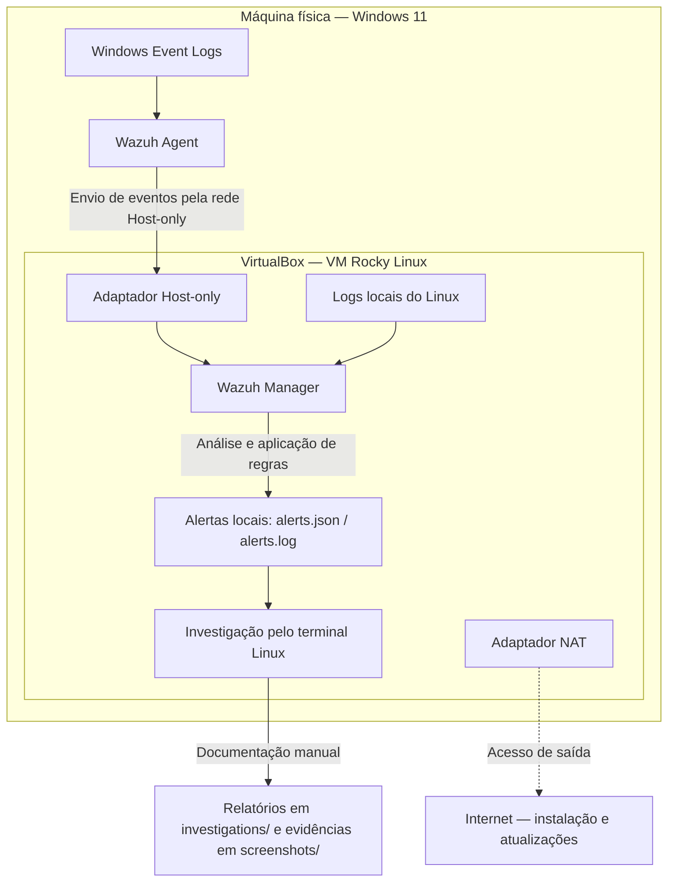

# Arquitetura do Laboratório Mini SOC

O laboratório utiliza um host Windows 11 monitorado por um Wazuh Agent e uma máquina virtual Rocky Linux, executada no VirtualBox, com o Wazuh Manager. A análise dos alertas é realizada pelo terminal Linux, sem Wazuh Indexer ou Dashboard.

## Topologia



O diagrama representa a organização do ambiente e o fluxo previsto dos eventos. A confirmação de um alerta específico depende das evidências de cada investigação.

## Componentes

| Componente | Localização | Responsabilidade |
|---|---|---|
| Windows 11 | Máquina física | Endpoint monitorado e host do VirtualBox |
| Windows Event Logs | Windows 11 | Fonte dos eventos do endpoint, incluindo eventos de segurança |
| Wazuh Agent | Windows 11 | Coletar e encaminhar eventos ao Manager |
| Rocky Linux | Máquina virtual | Hospedar o Manager e fornecer logs locais para monitoramento |
| Wazuh Manager | Rocky Linux | Receber eventos, aplicar regras e gerar alertas locais |
| Terminal Linux | Rocky Linux | Consultar o estado do agente e investigar alertas |
| Repositório | Documentação do laboratório | Registrar investigações e organizar evidências |

## Rede

A VM possui dois adaptadores com funções distintas:

| Adaptador | Finalidade |
|---|---|
| Host-only | Comunicação entre o agente no Windows e o Manager no Rocky Linux |
| NAT | Acesso da VM à internet para instalação de pacotes e atualizações |

O agente deve apontar para o endereço do Manager na interface Host-only. Endereços IP, portas configuradas e regras de firewall não estão registrados na documentação atual do projeto.

## Fluxo de monitoramento

1. O Windows registra eventos, que o Wazuh Agent coleta conforme sua configuração.
2. O agente encaminha os eventos ao Manager pela rede Host-only.
3. O Manager também recebe eventos dos logs locais do Rocky Linux.
4. O Manager analisa os eventos e gera alertas quando as condições das regras e da configuração de alertas são atendidas.
5. O analista consulta os alertas pelo terminal e registra a investigação em [`investigations/`](../investigations/), com evidências em [`screenshots/`](../screenshots/).

Os alertas ficam disponíveis em `/var/ossec/logs/alerts/alerts.json` e `/var/ossec/logs/alerts/alerts.log`. O registro de um evento na origem não garante, por si só, a geração de um alerta.

## Validação e estado atual

Conforme o [README principal](../README.md), o Manager e o agente Windows estão instalados, e a conectividade foi validada com o agente no estado `Active`:

```bash
sudo /var/ossec/bin/agent_control -l
```

A consulta contínua dos alertas pode ser realizada no Rocky Linux:

```bash
sudo tail -f /var/ossec/logs/alerts/alerts.json
```

A investigação [SOC-001 — Falha de Autenticação no Windows](../investigations/SOC-001-windows-failed-logon.md) confirmou a correlação do Event ID 4625, registrado às 15:21:33, com o alerta da regra 60122, de severidade 5, gerado às 15:21:35 para o agente `001` (`Windows-Host`). A ocorrência foi classificada como teste controlado autorizado e encerrada, validando a coleta e a detecção desse evento.

## Escopo

O ambiente tem finalidade educacional e concentra o monitoramento em uma única VM. Não inclui Wazuh Indexer, Dashboard ou resposta automatizada a incidentes. A triagem, a análise e a documentação das ocorrências são manuais.
