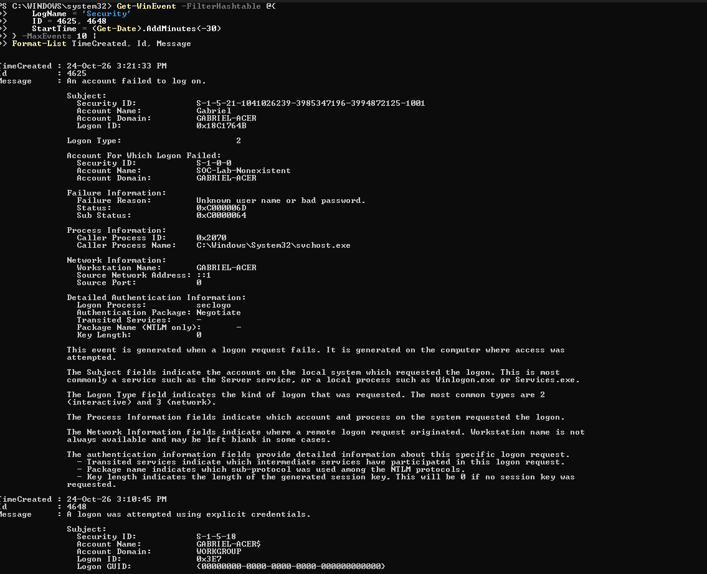
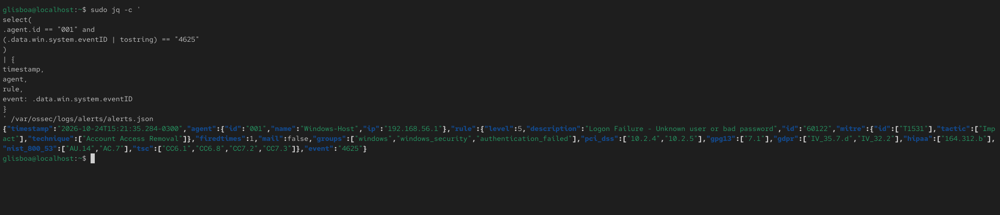

# SOC-001 — Investigação de Falha de Autenticação no Windows

## 1. Informações do Alerta

| Campo | Informação |
|---|---|
| Identificação | SOC-001 |
| Nome do Alerta | Falha de Autenticação no Windows |
| Event ID | 4625 |
| Wazuh Rule ID | 60122 |
| Severidade | Nível 5 |
| Fonte | Windows Security Event Log |
| Endpoint | Windows-Host |
| Ferramenta de Detecção | Wazuh Manager |
| Data da Investigação | 24/10/2026 |
| Status | Encerrado |

## 2. Descrição da Ocorrência

Foi realizada uma simulação controlada de falha de autenticação em um endpoint Windows 11, com o objetivo de validar a coleta de eventos de segurança e os mecanismos de detecção do Wazuh.

A atividade consistiu em tentar executar um processo utilizando as credenciais de uma conta inexistente, denominada `SOC-Lab-Nonexistent`.

O Windows registrou a tentativa malsucedida por meio do Event ID 4625, posteriormente identificado pelo Wazuh Manager, que gerou um alerta utilizando a regra 60122.

## 3. Coleta de Evidências

### 3.1 Logs do Windows

- **Event ID:** 4625
- **Data e horário:** 24/10/2026 às 15:21:33
- **Endpoint:** Windows-Host
- **Usuário:** SOC-Lab-Nonexistent
- **Tipo de logon:** 2 — Interativo
- **Endereço de origem:** ::1 (Loopback IPv6)
- **Motivo da falha:** Unknown user name or bad password
- **Status:** 0xC000006D
- **Substatus:** 0xC0000064
- **Processo:** `C:\Windows\System32\svchost.exe`
- **Pacote de autenticação:** Negotiate

### 3.2 Alerta do Wazuh

- **Agent ID:** 001
- **Agent Name:** Windows-Host
- **Rule ID:** 60122
- **Nível de severidade:** 5
- **Data e horário:** 24/10/2026 às 15:21:35
- **Descrição:** Logon Failure - Unknown user or bad password
- **Grupos:** windows, windows_security, authentication_failed
- **Event ID:** 4625

O alerta foi identificado no arquivo `/var/ossec/logs/alerts/alerts.json`, localizado no servidor Rocky Linux.

## 4. Análise da Ocorrência

### 4.1 Triagem Inicial

A investigação teve início com a geração de uma tentativa de autenticação malsucedida utilizando uma conta fictícia no Windows.

A primeira etapa consistiu em verificar a existência do evento no Windows Security Event Log, utilizando o PowerShell.

Após confirmar o registro do Event ID 4625, foi realizada uma consulta aos alertas do Wazuh Manager, filtrando os eventos provenientes do agente 001.

O Wazuh identificou a falha e gerou um alerta associado à regra 60122, com severidade de nível 5.

### 4.2 Análise dos Logs

A análise do evento permitiu identificar as seguintes informações:

**Event ID 4625 — Falha de autenticação**

O registro indica que uma tentativa de autenticação não foi concluída com sucesso.

**Logon Type 2 — Interativo**

Indica que a tentativa utilizou um mecanismo de autenticação interativa.

**Status 0xC000006D**

Representa uma falha de autenticação decorrente de credenciais inválidas.

**Substatus 0xC0000064**

Indica que a conta informada não existe no sistema.

**Endereço de origem ::1**

Corresponde ao endereço de loopback IPv6, indicando que a solicitação de autenticação teve origem na própria máquina.

**Correlação entre Windows e Wazuh**

O evento foi registrado no Windows às 15:21:33 e o alerta correspondente foi gerado pelo Wazuh aproximadamente dois segundos depois.

Essa correlação confirmou o funcionamento da coleta e do processamento do evento no ambiente monitorado.

### 4.3 Avaliação de Segurança

A atividade observada corresponde a uma tentativa de autenticação com uma conta inexistente.

Em um ambiente corporativo, eventos desse tipo podem exigir investigação adicional, principalmente quando associados a múltiplas tentativas, diferentes contas ou comportamentos anormais.

Entretanto, neste caso, a tentativa foi executada intencionalmente como parte de um teste autorizado.

Não foram identificadas evidências de comprometimento ou de acesso não autorizado relacionadas à ocorrência.

## 5. Classificação

**Classificação da ocorrência SOC-001:** Teste controlado autorizado.

**Justificativa:**

A tentativa de autenticação foi gerada intencionalmente com a conta inexistente `SOC-Lab-Nonexistent`. O Event ID 4625 e o alerta da regra 60122 confirmaram a detecção da falha no endpoint monitorado.

Não foram identificadas evidências de um incidente de segurança no escopo da simulação.

## 6. Ações Realizadas

- [x] Gerar uma tentativa controlada de autenticação com uma conta inexistente.
- [x] Confirmar o Event ID 4625 nos logs de segurança do Windows.
- [x] Consultar os alertas do Wazuh filtrando o agente 001 e o Event ID 4625.
- [x] Identificar o alerta correspondente à regra 60122, com severidade 5.
- [x] Correlacionar os horários do evento Windows e do alerta Wazuh.
- [x] Documentar as evidências da autenticação malsucedida.
- [x] Classificar a ocorrência como teste controlado autorizado.
- [x] Encerrar a investigação SOC-001.

## 7. Evidências

**Evidência 01 — Evento de segurança do Windows**

Captura de tela da consulta ao Windows Security Event Log pelo PowerShell, apresentando o Event ID 4625 registrado às 15:21:33 para a conta `SOC-Lab-Nonexistent`.

**Evidência 02 — Alerta do Wazuh e correlação com o Windows**

Captura de tela da consulta ao arquivo `alerts.json` no servidor Rocky Linux, filtrando o agente `001` e o Event ID `4625`.

**Resultado observado:** Alerta da regra 60122, com severidade 5, associado ao agente `Windows-Host`, registrado às 15:21:35.

## 8. Conclusão

A investigação confirmou a coleta do Event ID 4625 no Windows e a geração do alerta correspondente pelo Wazuh Manager, utilizando a regra 60122, com severidade 5.

A correlação entre os registros do Windows e do Wazuh validou a coleta e o processamento do evento de falha de autenticação no laboratório. A ocorrência foi classificada como teste controlado autorizado e encerrada.

**Status Final:** Encerrado

**Responsável:** Analista SOC — Laboratório
